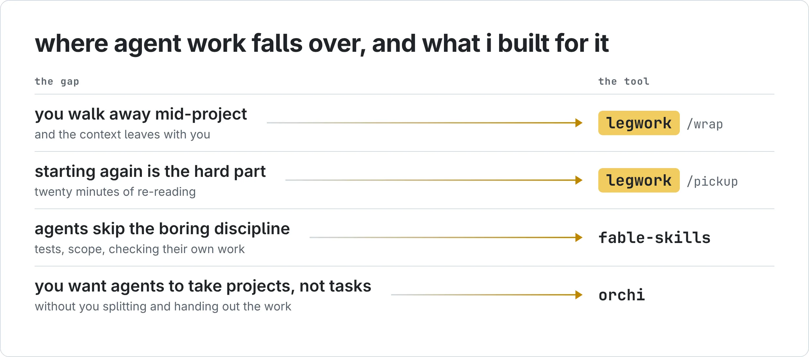
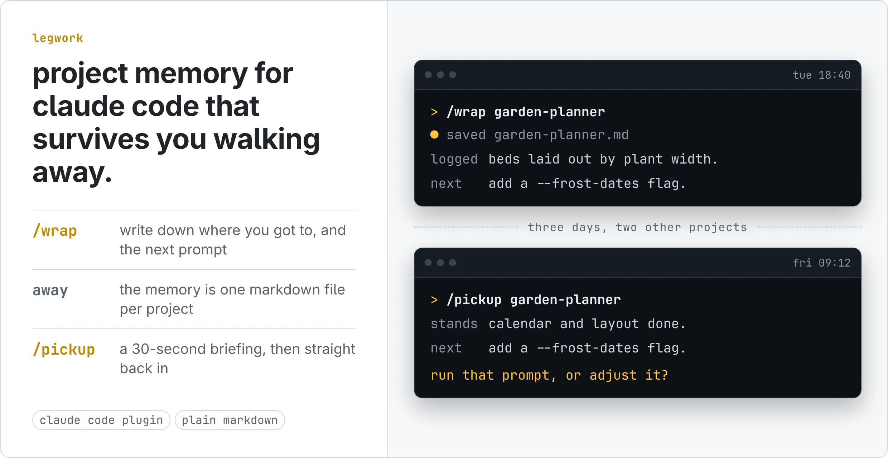

i'm adam, an applied ai engineer. i build the scaffolding around coding agents (memory, discipline, orchestration) for the way my own brain works, so the work survives my attention span. the patterns and the dead-ends go on [x](https://x.com/aae_on_x).

<picture>
  <source media="(max-width: 600px) and (prefers-color-scheme: dark)" srcset="assets/map-narrow-dark.webp" />
  <source media="(max-width: 600px)" srcset="assets/map-narrow-light.webp" />
  <source media="(prefers-color-scheme: dark)" srcset="assets/map-dark.webp" />
  
</picture>

### the one i'd start with

<a href="https://github.com/adamentwistle/legwork">
<picture>
  <source media="(max-width: 600px) and (prefers-color-scheme: dark)" srcset="assets/legwork-narrow-dark.webp" />
  <source media="(max-width: 600px)" srcset="assets/legwork-narrow-light.webp" />
  <source media="(prefers-color-scheme: dark)" srcset="assets/legwork-dark.webp" />
  
</picture>
</a>

two lines inside claude code:

```
/plugin marketplace add adamentwistle/legwork
/plugin install legwork@legwork
```

### the rest

- [**fable-skills**](https://github.com/adamentwistle/fable-skills): 39 engineering-discipline skills. on a blind-graded benchmark of single-turn answers across nine task areas, opus 5 went from 90% to 95% with the two or three relevant skills loaded. fable 5.1 bare scored 94%.
- [**orchi**](https://github.com/adamentwistle/orchi-build): for when you want agents to take on projects, not tasks. it plans the work, hands it out to claude code agents in herdr and only asks you when a decision needs a human. needs a mac.
- [**herdr-territory**](https://github.com/adamentwistle/herdr-territory) and [**claude-code-mods**](https://github.com/adamentwistle/claude-code-mods): see what your agents are doing, as a live map or a pixel-art office.
- [**agent-eng-kit**](https://github.com/adamentwistle/agent-eng-kit): stdlib tools for agent engineering. injection gauntlet, mcp replay proxy, session profiler.
