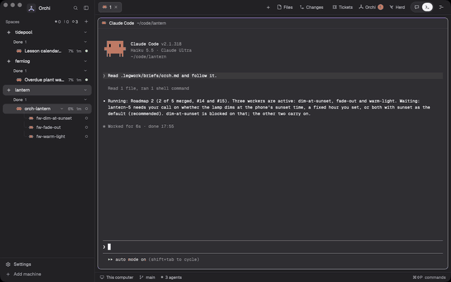
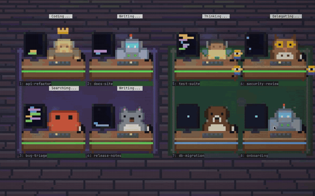
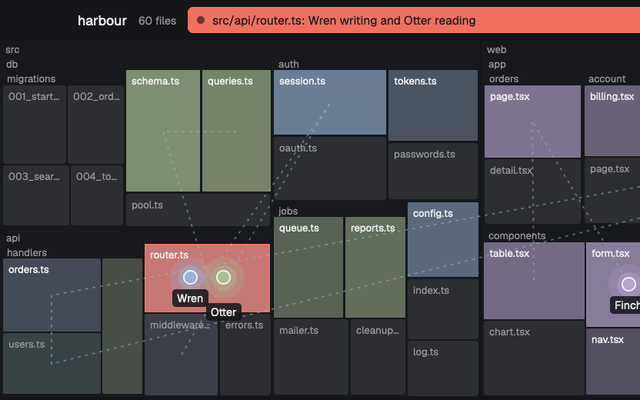
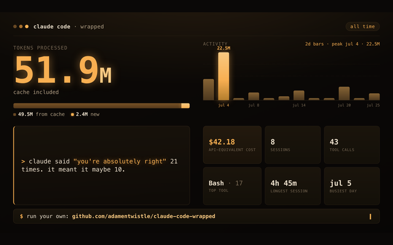

remarks come from the last push. a github action rebuilds the board every morning, based on <a href="https://github.com/adamentwistle/herdr-departures">herdr-departures</a>. agi is running late.

i'm an applied ai engineer at [quicknode](https://quicknode.com), where i build agentic systems you can measure and trust, on top of web3 infrastructure.

outside work i build tools for people running a lot of coding agents at once, and post the patterns and the dead-ends on [x](https://x.com/aae_on_x). most of it started as something i needed myself. i build for the way my own brain works, so the work survives my attention span. it turns out that's good design for anyone working with agents.

my thesis: ai agents are the next billion users of the internet, and the tooling layer is being built right now.

### 

**[fable-skills](https://github.com/adamentwistle/fable-skills)** · 39 engineering-discipline skills, each one a habit written down. with them loaded, opus 5 matched fable 5.1 running bare. no deps, mit.

<table>
<tr>
<td width="50%" valign="top">

  
  
<a href="https://github.com/ogulcancelik/herdr">herdr</a> set up for running many claude code agents at once, with a layer that plans the work and hands it out. needs a mac.
</td>
<td width="50%" valign="top">

  
  
every claude code session as a desk in a pixel-art office, animated by what it's doing. plus two more mods.
</td>
</tr>
<tr>
<td width="50%" valign="top">

  
  
your repo as a live map, with your coding agents moving around it. you can watch two of them walk into the same file.
</td>
<td width="50%" valign="top">

  
  
wrapped, but for your claude code usage. run it, get a share card, find out if your plan is a bargain or a problem.
</td>
</tr>
</table>

- **[legwork](https://github.com/adamentwistle/legwork)** · a project queue for claude code that survives you walking away. `/wrap` mints the next prompt while context is hot; `/pickup` briefs you back in thirty seconds.
- **[agent-eng-kit](https://github.com/adamentwistle/agent-eng-kit)** · small stdlib-only tools for agent engineering: a prompt-injection gauntlet, an mcp record/replay proxy, a session profiler, a context packer, an mcp doctor. no deps, no keys, mit.
- **[claude-code-tools](https://github.com/adamentwistle/claude-code-tools)** · zero-config doc linters for claude code projects.

### 

<!-- FEED:START -->
###  &nbsp;13 Nov 2026

- [Show HN: Kapso – Iterative learning from enterprise data](https://news.ycombinator.com/item?id=50471281)
- [Launch HN: Pomerado (YC F26) – Turn any website into an MCP for agents](https://news.ycombinator.com/item?id=50455811)
- [Show HN: Agents infer Lego mechanisms from sources, then animate them](https://github.com/anteloc/ldraw-mecha/tree/v0.5.0)
<!-- FEED:END -->

### 

 

&nbsp;&nbsp;
&nbsp;&nbsp;

